# Fitness Data Analysis

Bellabeat is a women-focused wellness technology company founded in 2013 that develops smart products designed to track health and lifestyle data. With a strong global presence and a digital-first marketing strategy, Bellabeat seeks to leverage smart device usage data to identify growth opportunities and enhance its marketing efforts. This project analyze the **FitBit Fitness Tracker Data** dataset using SQL and Python to identify patterns that can support better business decisions and marketing strategy.


## Table of Contents

- [1. Business Scenario](#1-business-scenario)
- [2. Dataset](#2-dataset)
- [3. Project Objective](#3-project-objective)
- [4. Key Questions](#4-key-questions)
- [5. Tools & Technologies](#5-tools--technologies)
- [6. Data Preparation & Processing (SQL)](#6-data-preparation--processing-sql)
  - [6.1 Import data to PostgreSQL](#61-import-data-to-postgresql)
  - [6.2 Data Transform](#62-data-transform)
- [7. Data Analysis (Python)](#7-data-analysis-python)
  - [7.1 Analysis for Activity and Sleep](#71-analysis-for-activity-and-sleep)
  - [7.2 Data Analysis for Activity and Weight](#72-data-analysis-for-activity-and-weight)
- [8. Recommendations](#8-recommendations)
  - [8.1 Promote Personalized Daily Activity Goals](#81-promote-personalized-daily-activity-goals)
  - [8.2 Encourage Movement and Reduce Sedentary Time](#82-encourage-movement-and-reduce-sedentary-time)
  - [8.3 Market Sleep Tracking Through Personalized Insights](#83-market-sleep-tracking-through-personalized-insights)

</br>


## **1. Business Scenario**

Bellabeat is a women-focused wellness technology company founded in 2013 that develops smart products designed to track health and lifestyle data. With a strong global presence and a digital-first marketing strategy, Bellabeat seeks to leverage smart device usage data to identify growth opportunities and enhance its marketing efforts.

</br>

## **2. Dataset**

This project uses the **FitBit Fitness Tracker Data** dataset (CC0: Public Domain), made available through Mobius on Kaggle. The dataset contains personal fitness tracker data from 30 consenting Fitbit users, including daily activity, step counts, heart rate, sleep, and weight records. These data provide valuable insights into user health behaviors and lifestyle patterns.

Raw data comes in total 29 files in **.csv** format, separated in two folders with different time range — one from 12 March 2016 to 11 April 2016, and the other from 12 April 2016 to 12 May 2016. 

*Data source: FitBit Fitness Tracker Data* *https://www.kaggle.com/datasets/arashnic/fitbit*

</br>

## **3. Project Objective**

This analysis explores the relationships among daily activity, sleep patterns, and weight to uncover key health insights, which will in turn inform and guide targeted marketing strategies.

</br>

## **4. Key Questions**

- How does physical activities affect sleep duration and quality? Which activity has the most positive effects?
- Is there a relationship between activity levels and weight / BMI for individual?
- What behavioral patterns can be identified among Fitbit users?
  
</br>

## **5. Tools & Technologies**

- **PostgreSQL** – Relational Database for data storage and management
- **DBeaver** – Database Client & GUI tool
- **SQL** – Data cleaning, ETL, transformation, and exploration
- **Python** – Data analysis, ETL and visualization (e.g. Pandas, Matplotlib)

</br>

## 6. Data Preparation & Processing (SQL)

### 6.1 Import data to PostgreSQL

This research will focus on activities, sleep and weight on a daily basis. Only daily-level and relevant data is imported among the total 29 files. The following are the steps I took:

(1) Open DBeaver and connect to PostgreSQL. Then create a new database **fitness.**

(2) Create schema **april_data** and **may_data** under **fitness.**

(3) Import .csv files into database. 
For data in folder 3.12.2016 to 4.11.2016, import **dailyActivity**, **minuteSleep**, and **weightLog** under **april_data** schema. 

<p align="center">
  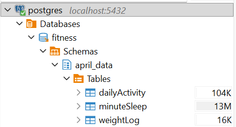
</p>

For data in folder 4.12.2016 to 5.12.2016, import **dailyActivity**, **dailySleep**, and **weightLog** under **may_data** schema.

<p align="center">
  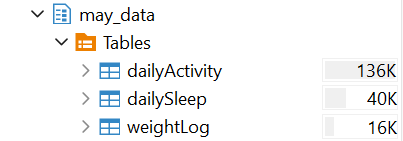
</p>

Data types and column names were standardized during the import process.

### 6.2 Data Transform

Data transformation was executed using SQL ([see full SQL scripts](sql/data_transform.sql)).

(1) Converted the **date** columns from text to date or timestamp, depending on the available information. Example:

```sql
ALTER TABLE may_data."dailyActivity" 
ALTER COLUMN "ActivityDate" TYPE DATE
USING to_date("ActivityDate", 'MM/DD/YYYY')
```

(2) Resampled the minute-level sleep data from March to April to a daily scale. In the **value** column, **1** means the user is asleep, while **0** means the user is awake.

```sql
SELECT "Id", DATE("date") AS "SleepDay", 
	SUM(CASE WHEN "value" = 1 THEN 1 ELSE 0 END) AS "TotalMinutesAsleep", 
	COUNT("value") AS "TotalTimeInBed"
FROM april_data."minuteSleep"
GROUP BY "Id", DATE("date")
ORDER BY "Id", DATE("date")
```

(3) “**UNION**” was used to combine data from the two schemas and formed new tables (naming as **all-xxx**) for both months. Created tables in public schema to store the results. Example:

```sql
-- Combine activity data in both months as new table "all-dailyActivity"
CREATE TABLE public."all-dailyActivity" AS
SELECT *
FROM april_data."dailyActivity" 
UNION ALL  
SELECT * 
FROM may_data."dailyActivity"
ORDER BY "id", "ActivityDate"
```

(4) Join daily activity and sleep data by user ID and date. Sleep records are shifted by one day to align overnight sleep data with the corresponding daytime activity records. The result was stored in a new table `all-dailyA&S`in public schema.

Below is a screenshot of the resulting joined table with 20 columns, showing the first 6 rows for reference:


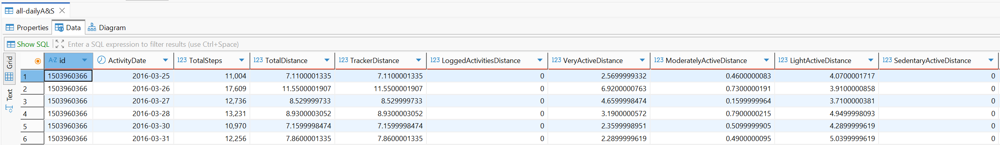

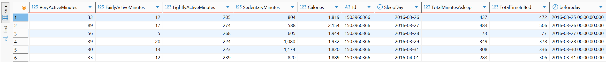


</br>


## 7. Data Analysis (Python)

Further data analysis would be conducted using Python in Jupyter Notebook. 

The analysis focuses on two primary objectives: first, to explore the relationship between daytime activity levels and night-time sleep quality; second, to examine whether an individual's weight or BMI influences their physical activity levels.

### 7.1 Analysis for Activity and Sleep

This part will start with the the final joined table of daily activity and daily sleep in public schema that created by SQL. The table has records of all the daily activities metrics for every user (e.g., **TotalSteps**, **TotalDistance**, **VeryActiveDistance**, **ModeratelyActiveDistance**, etc), as well as the daily sleep metrics for the corresponding night (e.g., **TotalMunitesAsleep** and **TotalTimeInBed**).

Following are the steps I took to analyse the relationship of these metrics using Python, with only core code snippets presented ([see full Python scripts in notebook](notebooks/activity_sleep_analysis.ipynb)).

#### **(1) Import data to pandas data frame**

This script establishes a connection to a PostgreSQL database using SQLAlchemy, retrieves the merged table of activity and sleep data (`all-dailyA&S`), and loads the results into a Pandas DataFrame.

#### **(2) Data cleaning for sleep records**

Exclude records where total sleep time is below 300 minutes, as values under 5 hours per day are considered unrealistic for typical sleep patterns and are likely caused by data recording errors. 

```python
df = df[df['TotalTimeInBed'] >= 300]
```

Also remove records for participants (IDs) with fewer than 20 days of observations, as the limited data is inadequate for conducting reliable correlation analysis.

```python
valid_ids = df_counts.loc[df_counts["counts"] >= 20, "Id"]
```

These step helps to achieve more responsible result in analysing.

#### **(3) Analysis for correlation**

Statistical and visualization libraries, including `**`seaborn`**`, and `**`matplotlib`**`, were used to perform correlation analysis and explore trends among key variables.

Firstly, define Sleep Quality as the percentage of **TotalMinutesAsleep** divided by **TotalTimeInBed**.

```python
# Sleep quality (%)
sleep_quality = (df['TotalMinutesAsleep'] * 100.0) / df['TotalTimeInBed']
```

Then, to account for individual baseline differences, we calculated the **participant-level Pearson correlation** between daily activity metrics and sleep quality for each user. The distribution of these individual correlations was then visualized using a **boxplot** to highlight overall trends and variability across users.

```python
# Plot distribution of participant correlations
plt.figure(figsize=(10, 6))

sns.boxplot(
    data=corr_df,
    x="Activity",
    y="Correlation"
)
```

The boxplot result shows as below:

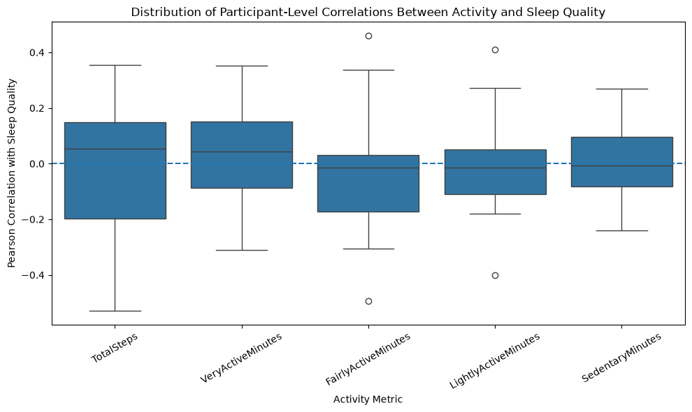


#### **(4) Conclusion**

Above graph shows the correlations between each metrics of activities and sleep quality are **generally weak**, with most median correlations close to zero.   
This suggests that daily activity levels have limited linear association with sleep quality across participants. The relationships vary considerably between individuals, indicating that activity may affect sleep differently depending on the person, and the overall impact is minimal.

### 7.2 Data Analysis for Activity and Weight

The correlation between activity and weight is analysed using the daily activity table and weight log table. Participants are categorized into four groups (underweight, healthy weight, overweight, and obese) based on their BMI value to observe potential activity patterns within each group.

Following are the steps I took to analyse using Python, with only core code snippets presented ([see full Python scripts in notebook](notebooks/activity_weight_analysis.ipynb)).

#### **(1) Import data to pandas data frame**

This step establishes a connection to a PostgreSQL database using SQLAlchemy, retrieves the table of weight log of both months ('`all_weightlog`'), and loads the results into a Pandas data frame called "`df`". Then retrieves the table of all daily activity of both months ('`all_dailyActivity`'), and loads the results into a Pandas data frame called "`df_activity`". 

#### **(2) Data categorization**

Based on WHO guidelines, BMI categories are classified as underweight (less than 18.5), healthy weight (18.5 to 25), overweight (25 to 30), and obese (more than 30).  
Participants (IDs) were categorized into these four groups to evaluate their activity patterns across different metrics.

```python
# Calculate average BMI for each person
avg_bmi = (
    df.groupby("Id", as_index=False)["BMI"]
      .mean()
      .rename(columns={"BMI": "Average_BMI"})
)

# Define BMI categories
bins = [0, 18.5, 25.0, 30.0, float("inf")]
labels = [
    "Underweight",
    "Healthy Weight",
    "Overweight",
    "Obese"
]
```

#### **(3) Data visualization**

Visualize daily activity metrics across different BMI categories to identify potential patterns or behavioral trends.  
Use statistical and visualization libraries, including ``seaborn``, and ``matplotlib``, to perform analysis and explore trends among key variables, showing in box plot and line chart visuals.

```python
activity_columns = [
    "TotalSteps",
    "VeryActiveMinutes",
    "FairlyActiveMinutes",
    "LightlyActiveMinutes",
    "SedentaryMinutes"
]

for col in activity_columns:

    plt.figure(figsize=(7,5))

    sns.boxplot(
        data=activity_bmi,
        x="BMI_Category",
        y=col,
        order=[
            "Underweight",
            "Healthy Weight",
            "Overweight",
            "Obese"
        ]
    )

    plt.title(f"{col} by BMI Category")
    plt.xlabel("BMI Category")
    plt.ylabel(col)

    plt.tight_layout()
    plt.show()
```

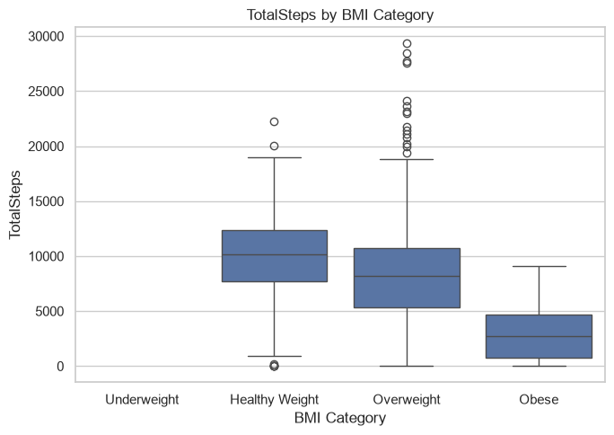

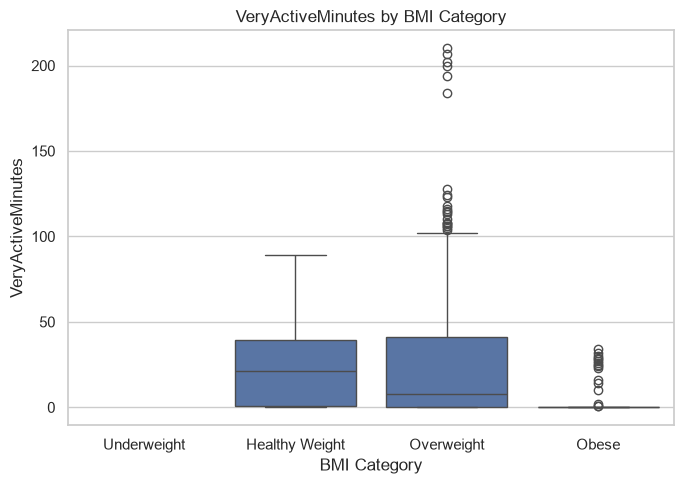

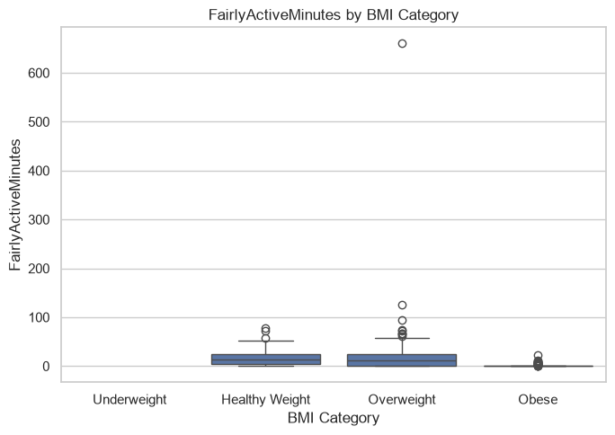

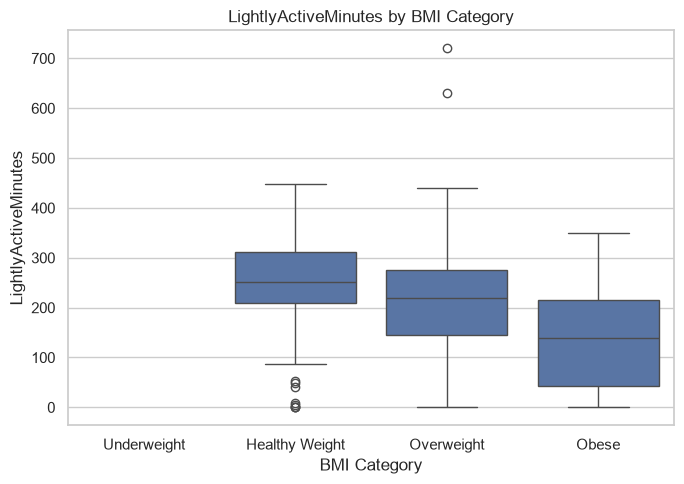

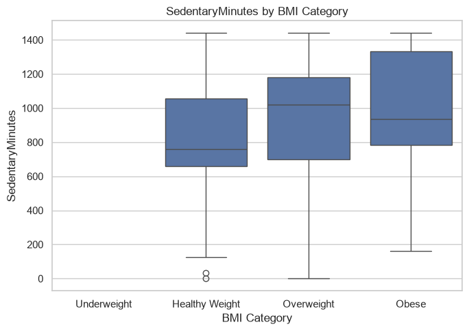

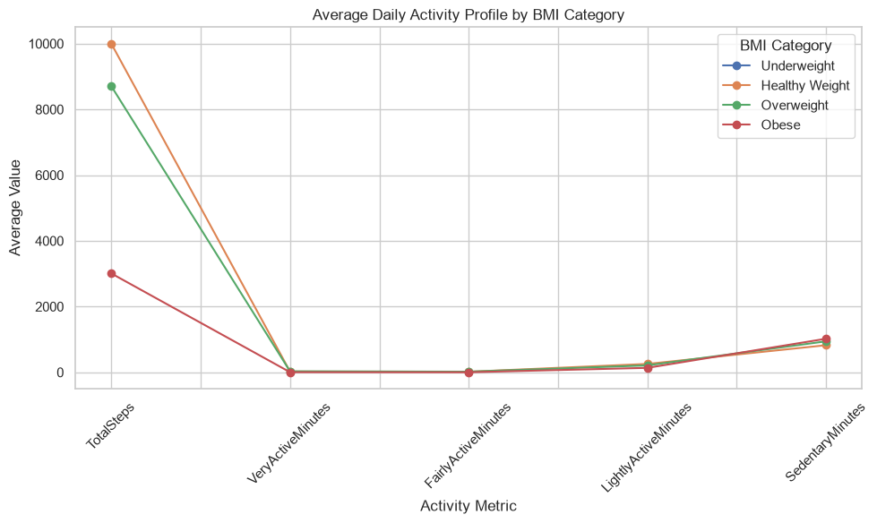

#### **(4) Conclusion**

The overall trend clearly demonstrates a negative relationship between body weight and activity levels across all categories:  

- **Physical Activity**: Engagement in total steps, very active, fairly active, and lightly active minutes decreases progressively from healthy weight to overweight and obese groups (Healthy Weight > Overweight > Obese).
- **Sedentary Behavior**: Conversely, sedentary minutes increase with body weight, showing the inverse hierarchy (Obese > Overweight > Healthy Weight).

</br>

## 8. Recommendations

Base on above conclusions, following are the recommendations for Bellabeat’s marketing strategy:

### 8.1 Promote Personalized Daily Activity Goals

Since activity levels tend to decrease from healthy-weight to overweight and obese groups, Bellabeat should encourage users to gradually increase their daily steps and active minutes through personalized goals. Features such as daily reminders, progress tracking, and achievement badges can help users build sustainable exercise habits.

**Marketing opportunity**: Launch a “Small Steps, Healthier You” campaign to motivate users to make small, achievable improvements in their daily activity.

### 8.2 Encourage Movement and Reduce Sedentary Time

The analysis shows that sedentary minutes increase across overweight and obese groups. Bellabeat could promote features such as inactivity alerts, hourly movement reminders, and short walking challenges to help users incorporate more movement into their daily routines.

**Marketing opportunity**: Introduce a “Move More, Sit Less” campaign that encourages users to take short walking breaks and rewards consistent participation rather than focusing solely on intense workouts.

### 8.3 Market Sleep Tracking Through Personalized Insights

Because the correlations between daily activity metrics and sleep quality are generally weak, Bellabeat should avoid claiming that increased activity directly improves sleep. Instead, it can position sleep tracking as a tool for helping users understand their individual sleep patterns and explore how lifestyle habits relate to their rest over time.

**Marketing opportunity**: Develop a “Know Your Sleep Patterns” campaign that highlights sleep tracking, personalized insights, and long-term wellness monitoring.
